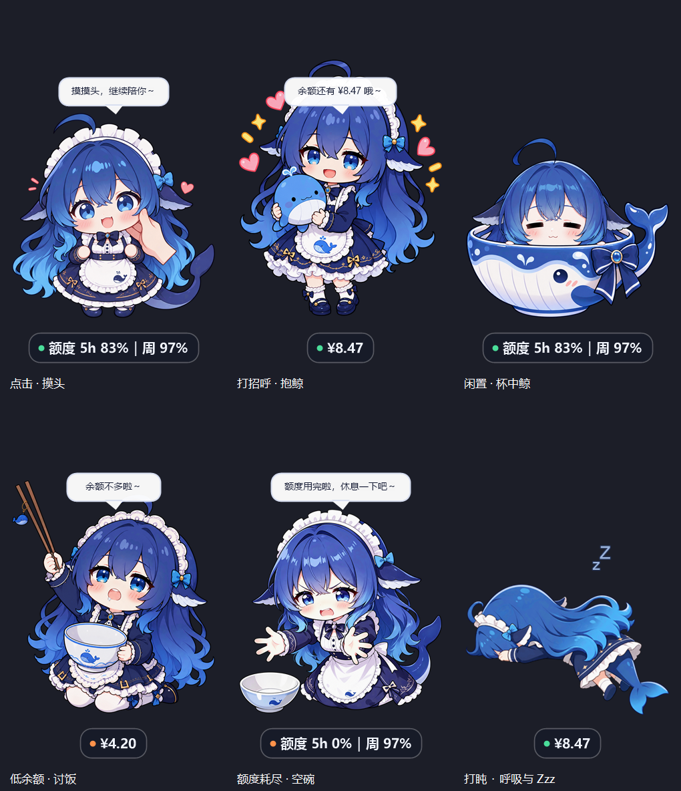

# Codex Balance Pet

[简体中文](README.md) | **English**

A blue-haired whale maid for your Windows desktop. Her sign follows your **current model provider**, showing an API account balance or official Codex usage quota. Drag her around, interact with her, or choose from 19 appearances. She writes while Codex is working and dozes off when idle.

The project also includes a **Codex plugin**: ask the agent to check your balance or remaining quota in chat. The pet starts automatically with Codex.

Download: [latest Release package](https://github.com/yzcjdxmx/codex-balance-pet/releases/latest).

**Interactions and account states**

<p>
  
</p>

**Working on a task**

<p>
  
</p>

[View all 19 appearances, artwork repairs, and state mappings](docs/artwork.md) (Chinese).

> PowerShell handles the transparent Windows window and animation. Node handles account queries and read-only task activity checks. No compilation or Electron is required.

## Features

- **Live balance or quota:** refreshes in the background every 30 seconds by default, without blocking dragging or animation. API accounts such as DeepSeek show money; official ChatGPT accounts show remaining Codex five-hour and weekly quota percentages. The status dot is green for normal operation, orange for low balance or exhausted quota, and red for a query failure.
- **Query status bubble:** displays `查询中. → 查询中.. → 查询中...` (querying), changing every 400 ms. The previous balance or quota from the same account stays visible during refresh.
- **Task animation:** plays a four-frame writing loop at 160 ms per frame while Codex tasks are running, considering multiple chats and subagents. Checking the balance itself does not trigger writing. The selected appearance returns when work finishes or stops.
- **Drag and remember:** drag the character to move it. Position is saved in `pet-state.json` and restored on restart.
- **Keep input focus:** enabled by default. Clicking or dragging the pet preserves focus in your current window. Toggle `不抢焦点` in the context menu; the preference is saved.
- **Always on top:** enabled by default. Uncheck `始终置顶` to let a game or another window cover the pet; check it again to restore this behavior. The change is immediate and saved, without extra background polling.
- **Quota reset countdown:** official Codex quota mode shows the earliest known reset window below the quota, for example `5h 重置还剩 4h 52m` (five-hour quota resets in 4 h 52 min) or `周 重置还剩 2d 3h 8m` (weekly quota resets in 2 d 3 h 8 min). Account details retain each window's exact reset time in Beijing time. The countdown remains visible with usage statistics hidden and updates locally from the last query, without extra quota requests. A passed deadline shows that it is waiting for fresh official data; missing reset times are reported as unavailable. Monetary API balances do not show a reset countdown.
- **Interaction:** click for a head-pat pose, dialogue, and an immediate balance refresh. Select `打个招呼` for a greeting with a whale plush.
- **19 appearances:** use `换个形象` to cycle through appearances in filename order. Your selection is saved. The six newer state illustrations can also be selected manually.
- **State artwork:** after 45 seconds of inactivity, the pet relaxes in a whale cup. At the sleep threshold, she lies down with gentle breathing and floating, fading `Zzz`. Low API balance uses a hungry bowl pose; exhausted official quota uses an empty-bowl pose; query failures use a worried face. Running tasks retain priority. See [artwork notes](docs/artwork.md) for sources, repairs, and prompts.
- **Context menu:** refresh the account, view account or usage details, greet, change appearance, toggle window preferences, return to the bottom-right corner, or exit. See the translation table below.
- **Transparent click-through areas:** fully transparent parts of the window do not block clicks on windows underneath.
- **Start and stop with Codex:** the plugin launches the pet without a console window. The pet exits after Codex has been absent for 15 seconds. A single-instance lock prevents duplicates.
- **Balance history:** monetary balances are appended to `pet\data\balance-log.csv` every 30 minutes by default, with a final entry on normal exit. Use `tools\余额报告.ps1` for consumption summaries and a chart.
- **Optional usage line:** displays information such as `用量 58.8M｜缓存 99%｜12.3k tok/s｜¥1.5/h` (token usage, cache ratio, output speed, and estimated hourly cost). Idle periods still show `0 tok/s`. Quota text uses font metrics to avoid clipping.
- **Chat tools:** the `balance` MCP server provides `get_balance` and `balance_alert`; `balance_pet` provides `pet` with start, stop, restart, and status actions.

`tok/s` is the output token count recorded in session logs over the last 30 seconds, divided by 30. It includes reasoning output and time spent waiting for tools; it is not instantaneous token-stream speed. A lightweight check reads small additions to the current log every second. Session discovery, historical catch-up, and cost calculations run every five seconds. Unchanged logs are not reparsed, unchanged text is not redrawn, and hiding the usage line pauses the one-second checks. `0 tok/s` is expected if no new usage has been logged or no output has occurred for 30 seconds. Large backlogs use the slower catch-up path. Timestamp parsing preserves UTC and timezone offsets.

## Quick start

### Requirements

| Component | Requirement |
|---|---|
| Operating system | Windows 10 or 11 |
| PowerShell | PowerShell 7 (`pwsh`); the query subprocess interface does not support Windows PowerShell 5.1 |
| Node | A runtime with `node:sqlite` support; scripts prefer the runtime bundled with Codex |
| Codex | Codex desktop or CLI, already signed in; the pet reads its existing configuration and credentials |

### Install

```powershell
# 1. Clone the repository.
git clone https://github.com/yzcjdxmx/codex-balance-pet.git
cd codex-balance-pet

# 2. Install the pet and plugin into your Codex home and start the pet.
pwsh -NoProfile -File tools\install.ps1

# 3. In Codex's plugin/marketplace settings, add this local marketplace:
#    %USERPROFILE%\.codex\local-marketplaces\balance
#    Then install the "balance" plugin (display name: 实时余额).
```

Alternatively, download and extract the [latest Release ZIP](https://github.com/yzcjdxmx/codex-balance-pet/releases/latest), open PowerShell in the extracted project directory, and run the same installer command.

Once installed, the pet starts with Codex. Ask in chat for your live balance, remaining quota, or a low-balance alert threshold.

To launch manually without a console window, double-click `pet\启动余额桌宠.vbs`. The `.cmd` launcher remains available for compatibility. To run the pet without installing the plugin:

```powershell
pwsh -NoProfile -File pet\balance-pet.ps1
```

For a custom Codex home:

```powershell
pwsh -NoProfile -File tools\install.ps1 -CodexHome "D:\CodexHome"
```

The installer passes the selected home to the launched child process. Set `CODEX_HOME` when launching from that custom directory later. Add `-NoRestart` to copy files without restarting the pet. Updates preserve position, appearance, preferences, and balance history.

### Context menu translations

The current pet interface and preview images use Chinese. This English README does not change the interface language.

| Menu label | Meaning |
|---|---|
| `立即刷新余额` | Refresh balance or quota now |
| `账户余额 / 额度详情` | Account balance / quota details |
| `显示用量信息` | Show usage statistics |
| `用量详情` | Usage details |
| `打个招呼` | Greet the pet |
| `换个形象` | Next appearance |
| `始终置顶` | Always on top |
| `不抢焦点` | Do not steal input focus |
| `回到右下角` | Return to the bottom-right corner |
| `退出` | Exit |

## Repository layout

```text
codex-balance-pet/
├── pet/                          Desktop pet
│   ├── balance-pet.ps1           Window, rendering, menus, timers
│   ├── account-client.ps1        Node query bridge and display formatting
│   ├── usage-reader.ps1          Session-log usage and token speed
│   ├── task-activity.ps1         Task activity detection
│   ├── task-activity-store.mjs   Read-only task database queries
│   ├── pet-host.ps1              Persistent MCP host and pet controls
│   ├── winless-launch.ps1        Launch without a console window
│   ├── window-interaction.ps1    Window activation and context menu
│   ├── start-pet.ps1             Manual launch helper
│   ├── 启动余额桌宠.vbs            Hidden manual launcher (.cmd also provided)
│   └── assets/                   PNGs and the writing animation atlas
├── plugin/
│   ├── .agents/plugins/marketplace.json
│   └── plugins/balance/
│       ├── .codex-plugin/plugin.json
│       ├── .mcp.json             MCP server configuration
│       ├── server.mjs            get_balance and balance_alert tools
│       ├── account.mjs           Shared account query logic
│       └── skills/balance/SKILL.md
├── tools/
│   ├── install.ps1              Repeatable installation and updates
│   ├── 余额报告.ps1               Balance history reports and charts
│   ├── extract-stickers.ps1     Extract artwork from an offline page
│   └── prepare-pet-art.ps1      Background removal, cropping, resizing
├── docs/preview/                Screenshots and animation previews
├── tests/                       Account, artwork, usage, window, install checks
└── LICENSE
```

## Balance and quota sources

Every refresh rereads the top-level `model_provider` in `~/.codex/config.toml` and the current authentication state.

| Account type | Source | Display |
|---|---|---|
| Official ChatGPT login | Codex `account/rateLimits/read`, without model inference or consuming inference quota | Remaining five-hour / weekly percentages and reset times in Beijing time |
| DeepSeek API | `GET /user/balance` | Monetary balance |
| Other API providers | Explicit `BALANCE_URL` pointing to a compatible balance endpoint | Monetary amounts returned by that endpoint |

- Without an explicit `model_provider`, the provider is treated as official OpenAI; a leftover `custom` section is not selected.
- A custom provider name such as `openai_http` also uses official quota when its endpoint is `https://chatgpt.com/backend-api/codex`, `requires_openai_auth = true`, and the current login mode is ChatGPT. A third-party address is not considered official based on its name alone.
- Credentials are read within Node, not passed between scripts. Launchers suppress stderr to prevent third-party error messages from exposing credentials.
- Low-balance thresholds apply only to monetary balances in the same currency, not official quota percentages.
- Official quota percentages are not written to monetary balance history.

Task detection reads the Codex task database and session events without modifying the database. Background account queries are separate from rendering. Stale unfinished events are checked against current database state to avoid a permanently busy animation.

## Change or add artwork

Place a prepared PNG such as `pet-look-19.png` in `pet\assets\` and restart the pet to add it to the appearance cycle. No code change is needed for an additional selectable appearance.

| File | Purpose |
|---|---|
| `pet-base.png` | Default appearance |
| `pet-look-01.png` … `pet-look-18.png` | Selectable appearances, cycled in filename order |
| `pet-happy.png` / `pet-greeting.png` / `pet-relaxed.png` | Whale-plush greeting / head pat / idle whale cup |
| `pet-sad.png` / `pet-hungry.png` / `pet-request.png` | Query failure / low API balance / exhausted official quota |
| `pet-sleepy.png` | Sleeping pose, with breathing and `Zzz` drawn at runtime |
| `pet-working-atlas-v1.png` | Transparent 2×2 four-frame writing atlas, read left to right, top to bottom |
| `pet-normal.png` / `pet-blink.png` | Open-eye and closed-eye frames for the default appearance |
| `pet-look-19-normal.png` / `pet-look-19-blink.png` (optional) | Eye frames for a custom appearance; not separate menu appearances. Without a matching blink frame, the pet keeps that appearance's normal pose |

Prepare artwork from an offline web page:

```powershell
# Extract image URLs and download them with the page's Referer header.
pwsh -NoProfile -File tools\extract-stickers.ps1 -Html "page.html" -OutDir "artwork\stickers" -Limit 40

# Remove the background, keep the main connected subject, crop, and fit to 320x400.
pwsh -NoProfile -File tools\prepare-pet-art.ps1 -Source "artwork\stickers\raw-025.jpg" -Name base -RemoveBackground
```

The preparation script's connected-component cleanup can remove detached decorations. For newer artwork and repaired assets, see [artwork notes and prompts](docs/artwork.md) (Chinese).

## Options and usage

```powershell
pwsh -NoProfile -File pet\balance-pet.ps1
pwsh -NoProfile -File pet\balance-pet.ps1 -RefreshSeconds 60  # Default: 30 seconds
pwsh -NoProfile -File pet\balance-pet.ps1 -Preview            # Render previews without a window
pwsh -NoProfile -File pet\balance-pet.ps1 -Headless           # Query the account once
```

`-IdleSleepSeconds` controls the idle sleep threshold, which defaults to 150 seconds. The pet does not sleep while tasks are running. Set a large value to effectively disable sleeping.

Generate balance consumption reports:

```powershell
pwsh -NoProfile -File tools\余额报告.ps1          # All recorded history
pwsh -NoProfile -File tools\余额报告.ps1 -Days 1  # Last day only
```

Reports include consumption over the selected period, hourly consumption, and a PNG chart. The default output directory is `docs\reports\`.

Run offline checks without reading actual account credentials or launching the pet:

```powershell
pwsh -NoProfile -File tests\task-activity.test.ps1
pwsh -NoProfile -File tests\install.test.ps1
pwsh -NoProfile -File tests\window-interaction.test.ps1
pwsh -NoProfile -File tests\sprite-frames.test.ps1
pwsh -NoProfile -File tests\launcher.test.ps1
pwsh -NoProfile -File tests\quota-reset.test.ps1
```

Window interaction checks use temporary test windows. Installation and launcher checks use isolated fixtures.

## Troubleshooting

**The pet does not appear.**

Check for duplicate processes: search Task Manager for `balance-pet.ps1`. If multiple instances exist, end them and start the pet again. Inspect `%TEMP%\balance-pet-status.json` for the process ID, account type, and latest error.

**The sign reports a query failure.**

Right-click and select `账户余额 / 额度详情` for details. For API accounts, check the selected provider's credentials and balance endpoint. For official accounts, check the Codex login and availability of its native executable.

**The balance stays at zero or belongs to a different account.**

Set `model_provider` explicitly in `~/.codex/config.toml` and check the selected provider's balance endpoint configuration. Other API providers require an explicit `BALANCE_URL`. Without a provider selection, the pet uses official OpenAI behavior.

**The reset countdown is unavailable or is waiting for a refresh.**

The countdown uses timestamps supplied by the official quota response. Missing timestamps are shown as unavailable. After a deadline, the pet waits for fresh official data instead of assuming quota has reset. Account details show individual windows' reset times in Beijing time.

**I do not want balance history.**

Set `-LogIntervalSeconds` to a sufficiently large value to make periodic logging infrequent. To prevent writes entirely, the Chinese README also describes removing `pet\data\balance-log.csv` and making the pet directory read-only; that affects other saved preferences as well. Official quota mode does not write monetary balance history.

**An artwork file is locked.**

Exit the pet using `退出`, or stop it manually before updating. Some image editors lock PNG files even though the pet itself supports loading replacement artwork.

## Possible improvements

- macOS and Linux support. The current transparent window implementation uses Win32 `UpdateLayeredWindow`.

## Artwork and attribution

- **Code:** MIT licensed; see [LICENSE](LICENSE).
- **Character artwork:** bundled assets are unofficial illustrations adapted from circulating DeepSeek sticker packs, including images from the Zhihu post “想求一些 DeepSeek 表情包？”, plus user-provided references and repairs described in [artwork notes](docs/artwork.md). Original artwork belongs to its respective creators. Assets are included as example appearances and will be removed or replaced if a rights holder objects. You can replace them with your own artwork.
- **Writing animation:** the four-frame atlas was generated using the same character as a reference and is an unofficial example asset.
- **Blink frames:** `pet-blink.png` preserves the original default character's closed-eye expression. Its matching `pet-normal.png` was edited with the built-in ImageGen tool and resized to 320×400. The prompt requested changing only the closed eyes to open blue eyes while preserving the character, pose, clothing, framing, and transparent background. This pair is used only for the default appearance.
- This is a personal project, unaffiliated with and not endorsed by OpenAI or DeepSeek. Names and marks including Codex, ChatGPT, and DeepSeek belong to their respective owners.
- Balance data is read on your machine for local display and is not uploaded elsewhere by this project.

## License

[MIT](LICENSE) © 2026 yzcjdxmx
