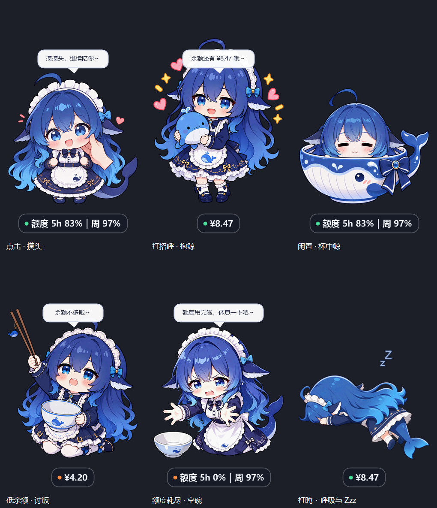
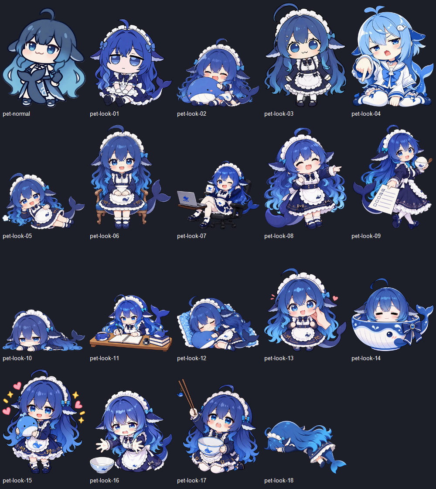

# 素材与状态

2026-10-19：通过内置 `image_gen` 编辑用户提供的六张参考图，并修复十二张旧形象。保留原始来图；项目中仅保存用于运行的透明 PNG。所有单张素材按比例放入 320×400 画布，四周留边，并保留爱心、鲸鱼吊坠等配件。





| 原始参考 | 自动状态 | 运行素材 | 手动形象 |
|---|---|---|---|
| `1792082010294.gif` | 闲置超过打盹阈值（默认 150 秒）；躺睡、轻微呼吸与 Zzz | `pet-sleepy.png` | `pet-look-18.png` |
| `1792082127318.png` | 左键点击摸头互动 | `pet-greeting.png` | `pet-look-13.png` |
| `1792082129472.png` | 无任务、普通状态闲置 45 秒后 | `pet-relaxed.png` | `pet-look-14.png` |
| `1792082132438.png` | 右键「打个招呼」抱鲸 | `pet-happy.png` | `pet-look-15.png` |
| `1792082208196.jpg` | 官方额度耗尽；空碗伸手 | `pet-request.png` | `pet-look-16.png` |
| `1792083309365.png` | API 余额低于已有阈值；举碗讨饭 | `pet-hungry.png` | `pet-look-17.png` |

任务写字优先级保持最高。查询失败继续使用 `pet-sad.png`，不会把连接故障表现成账户耗尽。打盹使用完整的静态躺睡图，由已有的 120ms 动画定时器做轻微呼吸和 Zzz；GIF 用作姿势参考，不逐帧播放原沙发背景动图。没有增加后台轮询或余额请求。

## 旧图修复

- `pet-look-01.png`：补齐底部硬截断的身体、裙摆、鞋子与尾巴。
- `pet-look-02.png`：清理抱鲸图的发丝、尾巴和衣裙白边，去掉地面阴影。
- `pet-look-03.png`：修复裙摆透明缺口，补齐下半身，并清理发丝内部背景。
- `pet-look-04.png`：去掉底部大字，补齐被遮挡的下半身与尾尖。
- `pet-look-05.png`：清理侧躺图的白边并补齐边缘，保留呼气小云朵。
- `pet-look-06.png`：清理当前椅子形象的白边，补齐头顶发梢和椅腿。
- `pet-look-07.png`：去掉背景重复人物、残线及底部大字，补齐椅子轮廓。
- `pet-look-08.png`：清理白边，去掉旁边重复的小人和文字泡，保留指向右侧的开心姿势。
- `pet-look-09.png`：去掉画外人手，补齐边缘并清理头发空隙，保留勾选单。
- `pet-look-10.png`：清理趴着图的发丝与袖口边缘，保留半睁眼的疲倦表情。
- `pet-look-11.png`：清理浮动文字和背景，补齐书桌边角。
- `pet-look-12.png`：修复枕头、头发、尾巴和脚部边缘。

缺失部位由图像编辑工具补绘，尽量贴近原画，并非恢复原作者未提供的像素。默认形象的眨眼配对和四帧写字图集保持原样。

## 内置图像工具最终提示词

这些提示词针对本次来图与旧图使用，最终结果再做等比缩放和透明留边，不在运行时生成图片。

### sleep

```text
Use case: background-extraction. Edit target: this reference image. Extract ONLY ONE whole blue-haired whale maid sleeping face-down on folded arms, with long flowing blue hair, navy maid dress, white frills, small stockinged legs and a complete whale tail. Remove the sofa, cushion, room and ALL background completely. Output a SINGLE clean isolated character cutout on TRUE transparent alpha background. Keep her exact resting pose and color palette. Frame the whole body with a generous 10 percent clear transparent margin all around. No grids, no additional copies, no sparkles or debris, no cast shadow, no text, no gradient. The white clothing stays opaque. Clean smooth silhouette with NO detached background fragments. This is a single desktop pet sprite.
```

### pat

```text
Use case: background-extraction. Asset type: transparent anime desktop pet sprite. Extract this exact cheerful blue whale maid character WITH the hand gently stroking her cheek as an affectionate greeting sprite. Remove white background to true alpha and remove the very large black sleeve so it does not dominate; retain a small coherent hand entering from right with a short clean wrist ending. Preserve face, full hairstyle, maid dress, shoes, whale tail and small pink heart. Fully fit the entire character including hair curl and shoes within transparent margins. Clean enclosed background holes, preserve white clothing opaque. Preserve illustration style and expression. No text or background scene.
```

### cup

```text
Use case: background-extraction. Asset type: transparent anime desktop pet sprite. Extract the exact serene blue-haired whale maid peeking from the whale teacup. True transparent background including enclosed spaces such as inside hair curl and around tail. Preserve solid white cup and white clothing. Repair the cropped far-right tip of the whale tail so the WHOLE cup, bow, hair curl and complete tail fit with generous margin on all sides. Do not alter face, closed content eyes, painting style or blue colors. No scene, no text, no opaque white rectangle. One complete centered sprite.
```

### hug

```text
Use case: background-extraction. Asset type: transparent anime desktop pet sprite. Make a clean transparent desktop-pet sprite of this EXACT happy blue-haired whale maid hugging the blue whale plush. Remove all Chinese caption lettering and white background; reconstruct the character's lower maid skirt, short legs and shoes where the caption occluded them, keeping chibi proportions and matching the reference linework. Preserve facial expression, hair, headband, whale plush and a few small hearts/sparkles. Complete intact silhouette with margins, all white clothing remains opaque. No text, no watermarks, no background.
```

### request

```text
Use case: background-extraction. Asset type: transparent anime desktop pet sprite. Create a transparent desktop-pet sprite from this exact imploring blue-haired whale maid kneeling and holding out her hands, with her empty bowl. Remove the entire top speech balloon and all lettering, remove the white background and bottom-right overlay. Preserve expressive eyes, hands, maid costume, kneeling posture, whale tail and empty bowl at left. Keep full silhouette and bowl with margins. Clean background holes while white fabric and bowl remain opaque. Match source anime art closely, no text, no scene.
```

### hungry

```text
Use case: background-extraction. Asset type: transparent anime desktop pet sprite. Extract this exact hungry blue-haired whale maid holding an empty blue-white bowl and raised chopsticks with small whale charm as a transparent desktop pet sprite. Remove the white background and Chinese bottom caption. Restore the lower maid skirt and kneeling body hidden behind the caption, matching chibi source style. Preserve the face, hair, maid band, complete chopsticks, charm and bowl. All parts fit with transparent margins, no clipped chopstick tips or hair. Clean enclosed white background holes, retain opaque white fabric and bowl. No text, no scene.
```

### pet-look-01.png

```text
Use case: precise-object-edit and background-extraction. Edit target: attached existing desktop pet sprite. The character was hard-cropped across chest at bottom. Keep the exact sleepy unimpressed face, hair color, eye shape, headband and whale tail. Complete her missing lower body as a small seated blue whale maid with matching dark maid dress, white apron, hands, short legs and shoes. Whole chibi silhouette, no cropped bottom. Keep original anime illustration identity, color palette and linework. True transparent background with clean antialiased edges, enclosed background gaps transparent, white fabric stays opaque. Fit entire subject fully inside the canvas with at least 5% transparent margin on every side. No scene or drop shadow. ONE character sprite.
```

### pet-look-03.png

```text
Use case: precise-object-edit and background-extraction. Edit target: attached existing desktop pet sprite. Repair the transparent holes mistakenly cut out of the dark skirt/apron area. Complete the cropped bottom into the FULL maid dress, legs and shoes with matching chibi proportions. Preserve the exact round-eyed awkward expression, sweat beads, hair, headband, posture and clothing design. The maid's white and black fabric must all be solid opaque. Keep original anime illustration identity, color palette and linework. True transparent background with clean antialiased edges, enclosed background gaps transparent, white fabric stays opaque. Fit entire subject fully inside the canvas with at least 5% transparent margin on every side. No scene or drop shadow. ONE character sprite.
```

透明边缘二次编辑：

```text
Precise cutout repair only: keep this exact maid illustration, face, complete dress and shoes. Remove the remaining WHITE BACKGROUND PATCHES trapped inside the hair loops, especially the long almond-shaped gap within the hair at lower-left and matching right-side gap. These enclosed gaps BETWEEN hair strands must be true transparent alpha=0, matching the outside transparent background. Do not make white maid clothing, skin, eye highlights or hair highlights transparent. No new artwork, no backdrop, preserve solid white apron and shoes.
```

### pet-look-04.png

```text
Use case: precise-object-edit and background-extraction. Edit target: attached existing desktop pet sprite. Preserve this exact light-blue-haired sailor whale girl, face, pointing-down gesture, short blue-white sailor uniform and tail. Remove bottom caption lettering. Complete any lower body and tail tip hidden by text or clipped by edges. Clean the white background fringe from hair/tail edges. Full coherent seated chibi figure, no text. Keep original anime illustration identity, color palette and linework. True transparent background with clean antialiased edges, enclosed background gaps transparent, white fabric stays opaque. Fit entire subject fully inside the canvas with at least 5% transparent margin on every side. No scene or drop shadow. ONE character sprite.
```

### pet-look-07.png

```text
Use case: precise-object-edit and background-extraction. Edit target: attached existing desktop pet sprite. Keep only the foreground blue whale maid lounging in the dark chair with cup and laptop. Remove the translucent duplicate character behind her, stray line across the upper background and all Chinese bottom caption. Preserve the foreground character's exact wink, pose, whale-tail and chair/laptop objects. Restore clean complete outlines and any lower chair legs hidden by caption. No ghost image, no background scraps or text. Keep original anime illustration identity, color palette and linework. True transparent background with clean antialiased edges, enclosed background gaps transparent, white fabric stays opaque. Fit entire subject fully inside the canvas with at least 5% transparent margin on every side. No scene or drop shadow. ONE character sprite.
```

### pet-look-09.png

```text
Use case: precise-object-edit and background-extraction. Edit target: attached existing desktop pet sprite. Preserve this exact blue-haired maid, full body dark dress, smiling face, rice bowl/spoon, held-out checklist card and whale tail. Remove the unrelated human hand intruding from bottom. Complete any clipped hair curl or shoe at edges and clean white fringes. Preserve checklist as a blank card with simple checkbox marks, no tiny illegible text. Whole isolated figure with margins. Keep original anime illustration identity, color palette and linework. True transparent background with clean antialiased edges, enclosed background gaps transparent, white fabric stays opaque. Fit entire subject fully inside the canvas with at least 5% transparent margin on every side. No scene or drop shadow. ONE character sprite.
```

透明边缘二次编辑：

```text
Precise cutout repair only: keep the exact maid with rice bowl and checklist. Remove remaining solid WHITE BACKGROUND ISLANDS between the separated flowing blue hair curls, especially the white crescent/triangular holes left of the neck and in the hair sweeping to the left. Make all genuine empty hair gaps transparent alpha=0. Preserve white clothing, skin, rice, bowl, checklist and hair shine opaque. Preserve pose, exact outline and all objects. No scene or backdrop.
```

### pet-look-11.png

```text
Use case: precise-object-edit and background-extraction. Edit target: attached existing desktop pet sprite. Preserve the exact focused blue-haired whale maid writing in a notebook at her wooden desk, whale tail, books, ink bottle and cup. Remove the floating top Chinese caption and small bottom-right lettering. Restore full desk corners so nothing is cropped by image boundaries. Clean white background halos and preserve all white paper, collar and apron. Keep original anime illustration identity, color palette and linework. True transparent background with clean antialiased edges, enclosed background gaps transparent, white fabric stays opaque. Fit entire subject fully inside the canvas with at least 5% transparent margin on every side. No scene or drop shadow. ONE character sprite.
```

透明边缘二次编辑：

```text
Only remove the dark blue/brown gradient background and cast shadows from this writing-maid sprite. Produce TRUE transparent alpha=0 wherever no character, desk, cup or book exists. Preserve every foreground pixel and the complete desk corners. No colored backdrop, no black rectangle, no vignette. Keep the desk, figure, white notebook and dress fully opaque. Clean professional isolated transparent cutout.
```

### pet-look-12.png

```text
Use case: precise-object-edit and background-extraction. Edit target: attached existing desktop pet sprite. Preserve this exact sleeping blue-haired maid curled on her blue whale plush and dotted blue pillow, closed eyes, dark maid costume and whale tail. Clean ragged white/background scraps around pillow and hair, restore complete pillow corners, tail and toes that were clipped. Whole sleeping character plus pillow, not a scene. Keep all interior white frills and patterns opaque. Keep original anime illustration identity, color palette and linework. True transparent background with clean antialiased edges, enclosed background gaps transparent, white fabric stays opaque. Fit entire subject fully inside the canvas with at least 5% transparent margin on every side. No scene or drop shadow. ONE character sprite.
```

### pet-look-02.png

```text
Use case: precise-object-edit and background-extraction. Preserve this EXACT smiling closed-eye chibi blue-haired whale maid hugging the large blue whale plush, seated with both small feet visible and tail to the right. Clean jagged white extraction halos on hair, tail and dress edges. Remove the gray oval floor shadow under her. Restore any clipped outer hair curl or tail tip. Keep all intended white frills and whale belly solid. Complete isolated character and plush with ample transparent margins. Match the original anime illustration identity and drawing style. Output ONE production desktop pet sprite with TRUE transparent alpha background, no gray/black/white rectangle, no ground shadow, no floating scraps. Empty enclosed spaces between hair curls must also be transparent. All intentional white clothing stays opaque.
```

### pet-look-05.png

```text
Use case: precise-object-edit and background-extraction. Preserve this EXACT blue-haired whale maid lying sideways with head on left hand, other hand on her apron, dark maid dress and extended whale tail at right. Clean jagged white background fringe around hair and tail. Restore complete hair tips, feet, skirt and tail so nothing is clipped. Keep the small intentional breath puff at left. Match the cute relaxed pose and original colors; solid opaque white apron and socks. Match the original anime illustration identity and drawing style. Output ONE production desktop pet sprite with TRUE transparent alpha background, no gray/black/white rectangle, no ground shadow, no floating scraps. Empty enclosed spaces between hair curls must also be transparent. All intentional white clothing stays opaque.
```

### pet-look-06.png

```text
Use case: precise-object-edit and background-extraction. Preserve this EXACT front-facing blue-haired whale maid seated upright on the wooden armchair, hands folded on lap, smiling blue eyes, white apron with whale motif, feet together and whale tail extending to right. Repair clipped top hair curl and jagged white fringes around all hair, frills, chair legs and tail. Make fully clean smooth alpha edges with no background fragments. Preserve proportions, chair and character design. Complete full chair, shoes, tail and curl fit with generous transparent margins. No added props or scene. Match the original anime illustration identity and drawing style. Output ONE production desktop pet sprite with TRUE transparent alpha background, no gray/black/white rectangle, no ground shadow, no floating scraps. Empty enclosed spaces between hair curls must also be transparent. All intentional white clothing stays opaque.
```

### pet-look-08.png

```text
Use case: precise-object-edit and background-extraction. Preserve this EXACT happy blue whale maid pointing to the right and smiling closed eyes. Remove the entire thought bubble, its caption and the duplicate miniature character inside it, so this becomes a clean single-character desktop sprite. Preserve the original pointing gesture, dress, apron, hairstyle and whale tail. Repair ragged white extraction fringe and complete the full skirt, legs and shoes. No text or duplicate figure. Match the original anime illustration identity and drawing style. Output ONE production desktop pet sprite with TRUE transparent alpha background, no gray/black/white rectangle, no ground shadow, no floating scraps. Empty enclosed spaces between hair curls must also be transparent. All intentional white clothing stays opaque.
```

### pet-look-10.png

```text
Use case: precise-object-edit and background-extraction. Preserve this EXACT sleepy unimpressed blue-haired whale maid lying flat face-down with her chin on both little hands and long hair spread sideways, tail curling up at right. Improve soft jagged cutout edges and remove white background fringe without losing white headband or sleeve frills. Keep the same low flat pose and half-open tired eyes. Complete both side hair tips and whale tail, no missing/cropped pixels, generous transparent margin. Match the original anime illustration identity and drawing style. Output ONE production desktop pet sprite with TRUE transparent alpha background, no gray/black/white rectangle, no ground shadow, no floating scraps. Empty enclosed spaces between hair curls must also be transparent. All intentional white clothing stays opaque.
```

